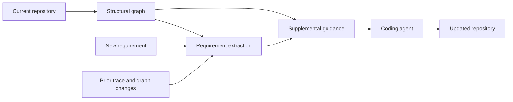

# RepoTrace

<div align="center">

**Improving Requirement Tracking in Multi-Round Agent Interactions**

Requirement-driven repository context for coding agents.

*Anonymous research release*

[Overview](#overview) · [Installation](#installation) · [Quick Start](#quick-start) · [Experiments](#reproducing-experiments) · [Repository Layout](#repository-layout)

</div>

## Overview

**RepoTrace** helps coding agents reason about an evolving repository as new requirements arrive. Before each round, it combines the current repository structure, the new request, and records from earlier rounds into concise, supplemental guidance. The agent then implements the request using its existing tools.

This repository accompanies **RepoTrace: Improving Requirement Tracking in Multi-Round Agent Interactions** and provides adapters for **Terminus-2** and **Claude Code**, a bundled Harbor runner, and evaluation utilities for EvoCode-Bench.

- **Repository structure.** Collect source files and symbols, approximate import and call relationships, and identify structurally central files.
- **Requirement tracking.** Extract target files, symbols, behavioral constraints, and potentially affected prior components using an LLM, with a deterministic keyword fallback.
- **Cross-round context.** Combine structural changes and previous requirement records into guidance about repository hubs, existing components, and components the current request may affect.
- **Inspectable artifacts.** Save graph snapshots, requirement records, and the injected message for each round.



RepoTrace runs at inference time and requires no model training. Its graph is a lightweight, heuristic approximation built from source patterns and name matching. Saved requirement records describe earlier analyses; they are not proof that those requirements were successfully implemented. The injected message selects structural and cross-round context rather than reproducing every extracted field.

## Installation

Use **Linux**, **Python 3.12+**, and a working **Docker Engine with Docker Compose**. The bundled runner uses Docker host networking. Repository collection also requires standard shell tools: `sh`, `find`, `grep`, `sed`, `sort`, and `head`. Model-backed experiments require access to a model endpoint.

Run the following from the repository root, which contains `repotrace/`, `harbor-local/`, and `evaluation/`:

```bash
python3.12 -m venv .venv
source .venv/bin/activate
python -m pip install --upgrade pip
python -m pip install -e ./harbor-local

export REPOTRACE_ROOT="$(pwd)"
export PYTHONPATH="$REPOTRACE_ROOT${PYTHONPATH:+:$PYTHONPATH}"

harbor run --help
chmod +x evaluation/run_single.sh
```

Install the bundled `harbor-local/` implementation to use the runtime included with this release. Its dependencies include LiteLLM for requirement extraction. RepoTrace is imported from the repository root through `PYTHONPATH`; it has no separate installation step.

## Quick Start

### 1. Run an offline check

```bash
python -m repotrace.selftest ./repotrace
```

This collects the local source tree, builds its graph, runs keyword-based extraction, and prints a guidance preview. It requires neither Docker nor a model API. The CLI accepts a source directory and an optional instruction file as positional arguments; for a task-specific preview, supply a task's starter workspace and round instruction.

### 2. Prepare the benchmark

Task data is distributed separately. Download the task-only `archives/evocodebench_wotraj.tar.zst` release from the [EvoCode-Bench dataset](https://huggingface.co/datasets/UnipatAI/EvoCodeBench), then extract it with a Zstandard-capable tool and arrange the task directories as follows:

```text
data/EvoCodeBench/
└── theme_d1_w1_code_build_greenfield_implementation/
    ├── task.toml
    ├── environment/
    └── steps/
        ├── round-1/
        │   ├── instruction.md
        │   ├── solution/
        │   └── tests/
        └── ...
```

Validate the prepared tasks:

```bash
export TASKS_DIR="$REPOTRACE_ROOT/data/EvoCodeBench"
python evaluation/validate_dataset.py "$TASKS_DIR"
```

The benchmark used in the paper contains **26 tasks and 227 rounds**, with **5–15 rounds per task** and cumulative tests. Retain the dataset revision or archive checksum with each experiment.

### 3. Configure the model

The following example uses Terminus-2 with an OpenAI-compatible endpoint. Replace the endpoint, key, and model identifier with values supported by your provider.

```bash
export OPENAI_API_KEY="<your-api-key>"
export OPENAI_API_BASE="https://<your-endpoint>/v1"
export AGENT_MODEL="openai/glm-5.2"
export AGENT_TYPE="repotrace.agents.terminus:RepoTraceTerminus2"
export HARBOR_BIN="harbor"
export HARBOR_ENV="docker"
export AGENT_ATTEMPTS=1
export HARBOR_N_CONCURRENT=1

export REPOTRACE_MODEL="$AGENT_MODEL"
export REPOTRACE_API_BASE="$OPENAI_API_BASE"
unset REPOTRACE_OFF

export MODEL_TAG="${AGENT_MODEL##*/}"
```

**Set `REPOTRACE_MODEL` explicitly to enable LLM-based extraction.** The current adapters do not automatically copy the agent's model into RepoTrace. If the variable is absent, or extraction fails, RepoTrace uses its keyword fallback. LiteLLM provider prefixes such as `openai/` apply to both the Terminus-2 model and the extraction model.

### 4. Run one task with RepoTrace

```bash
export TASK="$TASKS_DIR/theme_d1_w1_code_build_greenfield_implementation"
export TASK_NAME="$(basename "$TASK")"
export RUN_ID="$(date -u +%Y%m%dT%H%M%SZ)"
export RESULTS_DIR="$REPOTRACE_ROOT/results/quickstart-$RUN_ID"

bash evaluation/run_single.sh "$TASK" agent \
  --jobs-dir "$RESULTS_DIR/$TASK_NAME/harbor_jobs/$MODEL_TAG"
```

This runs the task's full sequence of rounds with the configured agent. Specify `agent` explicitly: omitting the mode runs both the oracle and the coding agent. The script also accepts `oracle` and `nop` for reference-solution and no-op checks. Inspect the per-round verifier outputs and RepoTrace artifacts under the generated trial directory. The output hierarchy is intentional: the scoring script identifies tasks by their directory names and models by `harbor_jobs/<model>/`.

## Reproducing Experiments

### Paired baseline and RepoTrace runs

After Quick Start, compare both variants on the same task using identical model settings. Save each variant separately:

```bash
export RESULTS_DIR="$REPOTRACE_ROOT/results/paired-$(date -u +%Y%m%dT%H%M%SZ)"

AGENT_TYPE=terminus-2 bash evaluation/run_single.sh "$TASK" agent \
  --jobs-dir "$RESULTS_DIR/base/$TASK_NAME/harbor_jobs/$MODEL_TAG"

AGENT_TYPE=repotrace.agents.terminus:RepoTraceTerminus2 \
  bash evaluation/run_single.sh "$TASK" agent \
  --jobs-dir "$RESULTS_DIR/repotrace/$TASK_NAME/harbor_jobs/$MODEL_TAG"
```

### Convenience batch runner

For a single agent configuration, `run_all.sh` runs each `theme_*` task containing a `task.toml`:

```bash
bash evaluation/run_all.sh "$TASKS_DIR" agent
```

It uses the same environment variables as `run_single.sh`, continues after individual task failures, and returns a nonzero status if any task failed. It invokes `run_single.sh` directly, so retain that file's executable permission or run the `chmod` command in Installation.

Results use the default `<task>/harbor_jobs/<model-short>/` location; score them with `--results-dir "$TASKS_DIR"`. This helper accepts only the task root and mode, and does not forward extra command-line options such as `--jobs-dir`. Keep baseline and RepoTrace results in separate directories. The scoring commands below use the single-task comparison layout above.

### Score the runs

```bash
for variant in base repotrace; do
  python evaluation/compute_metrics.py \
    --tasks-dir "$TASKS_DIR" \
    --results-dir "$RESULTS_DIR/$variant" \
    --model "$MODEL_TAG" \
    --json
done
```

For complete coverage with one attempt per task, the output maps to the paper's task-level metrics as follows:

| Output field | Paper metric | Meaning |
| --- | --- | --- |
| `mean_reward` | MPR | Mean fraction of passed rounds, averaged across tasks. |
| `final_step_completion_rate` | FCR | Percentage of tasks whose final round passes. |
| `perfect_task_rate` | PTR | Percentage of tasks that pass every round. |
| `hard_task_rate` | HTR | Percentage of tasks with a round pass rate of at most 50%. |

These fields are reported on a 0–100 scale. Check that `evaluated` equals `tasks` before reporting a full-benchmark comparison. Missing rounds within an existing trial count as failures. Entirely unevaluated tasks are excluded from `mean_reward` and `hard_task_rate`, but remain in the denominator for completion and perfect-task rates. Repeated runs in the same directory are treated as additional attempts.

For a supplementary view of partial test-case success by round:

```bash
python evaluation/compute_round_pass_rate.py \
  --results-dir "$RESULTS_DIR/repotrace" \
  --model "$MODEL_TAG" \
  --max-round 15
```

This diagnostic reads `CASE_SUMMARY` from verifier logs, uses the latest trial per task, and averages per-task case pass ratios at each round. It is not a complete implementation of the paper's TCS or token accounting.

### Session policy and reproduction scope

The current Terminus-2 adapter preserves the task workspace and RepoTrace's in-memory trace across rounds, while its underlying agent starts a fresh conversation for each round. Terminus-2 in this snapshot does not support `--resume-trajectory`. Claude Code supports that flag, including through the RepoTrace adapter.

The paper describes persistent agent sessions, and its appendix includes a historical guidance example that differs from the current concise message. The commands above reproduce the evaluation workflow of this code snapshot. Exact paper-table reproduction also requires the matching code and dataset revisions, prompts, model settings, and session policy.

## Agent Entrypoints and Configuration

| Agent scaffold | Baseline `--agent` | RepoTrace `--agent` |
| --- | --- | --- |
| Terminus-2 | `terminus-2` | `repotrace.agents.terminus:RepoTraceTerminus2` |
| Claude Code | `claude-code` | `repotrace.agents.claude:RepoTraceClaudeCode` |

For Claude Code, configure an Anthropic-compatible endpoint separately from the host-side extraction endpoint. Use Harbor directly when enabling session resumption: `run_single.sh` does not expose `--resume-trajectory`.

```bash
export ANTHROPIC_API_KEY="<your-anthropic-compatible-api-key>"
export ANTHROPIC_BASE_URL="https://<your-anthropic-compatible-endpoint>"
export CLAUDE_MODEL="<model-id-supported-by-that-endpoint>"

harbor run \
  --path "$TASK" \
  --agent repotrace.agents.claude:RepoTraceClaudeCode \
  --model "$CLAUDE_MODEL" \
  --env docker \
  --resume-trajectory \
  --n-attempts 1 \
  --n-concurrent 1 \
  --jobs-dir "$REPOTRACE_ROOT/results/claude-$RUN_ID/$TASK_NAME/harbor_jobs/${CLAUDE_MODEL##*/}"
```

Keep `REPOTRACE_MODEL` and its provider credentials configured for requirement extraction. For a paired Claude Code baseline, replace the adapter with `claude-code`, use a separate results directory, and keep `--resume-trajectory` and all other settings identical. Harbor normally installs the Claude CLI in the task environment; `HARBOR_CLAUDE_LOCAL_BIN` optionally points to a compatible pre-downloaded binary on the host.

| Variable | Purpose |
| --- | --- |
| `PYTHONPATH` | Include the repository root so Harbor can import `repotrace`. |
| `HARBOR_BIN` | Harbor command used by the launcher; set to `harbor` after installing the bundled runtime. |
| `AGENT_TYPE`, `AGENT_MODEL` | Agent entrypoint and coding model passed by the launcher. |
| `AGENT_ATTEMPTS` | Attempts per task; default `1`. |
| `HARBOR_N_CONCURRENT` | Concurrent attempts; defaults to `AGENT_ATTEMPTS`. |
| `HARBOR_ENV` | Execution environment; default `docker`. |
| `AGENT_KWARGS` | Optional JSON object converted into Harbor `--agent-kwarg` arguments; use the same settings for paired runs. |
| `REPOTRACE_MODEL` | LiteLLM model identifier for requirement extraction; unset selects keyword extraction. |
| `REPOTRACE_API_BASE` | Extraction endpoint; falls back to `OPENAI_API_BASE`. |
| `REPOTRACE_OFF=1` | Disable RepoTrace guidance injection. |
| `OPENAI_API_KEY`, `OPENAI_API_BASE` | Credentials and endpoint for the OpenAI-compatible examples. |
| `ANTHROPIC_API_KEY`, `ANTHROPIC_BASE_URL` | Credentials and endpoint for the Claude Code example. |

The launcher also offers `--start-step` and `--end-step`, but the bundled Harbor CLI does not implement these flags or `--fast-forward-mode`. The examples here run full task sequences; step slicing requires a compatible Harbor fork.

An extraction failure triggers keyword fallback. An exception in the overall RepoTrace message-building path skips injection for that round. Inspect the saved `entities.source` field (`llm` or `fallback`) to confirm which extraction path was used.

## Repository Layout

```text
.
├── repotrace/                 # RepoTrace implementation
│   ├── agents/                # Terminus-2 and Claude Code adapters
│   ├── core.py                # Per-round orchestration and trace persistence
│   ├── graph.py               # Source collection, graph construction, and deltas
│   ├── entities.py            # LLM and keyword-based requirement extraction
│   ├── message.py             # Supplemental repository guidance
│   ├── selftest.py            # Offline smoke check
│   ├── viz.py                 # HTML reports from trial artifacts
│   └── reconstruct.py         # Best-effort reconstruction from trajectories
├── harbor-local/              # Bundled Harbor runtime and dependencies
├── evaluation/                # Benchmark launchers, validation, and analysis
│   ├── run_single.sh          # One task: agent, oracle, nop, or all
│   ├── run_all.sh             # Convenience runner over all task directories
│   ├── validate_dataset.py    # Task-format validation
│   └── compute_metrics.py     # Task-level metrics
├── scripts/                   # Environment-specific experiment helpers
├── tools/                     # Auxiliary runtime metadata
├── docs/                      # Inherited EvoCode-Bench result browser
├── legacy/                    # Earlier EvoCode-Bench runner and evaluation assets
├── data/EvoCodeBench/          # Task data; download separately
└── results/                   # Evaluation outputs
```

### Trial artifacts

After Harbor archives a round's outputs, RepoTrace artifacts are available under:

```text
<trial>/steps/round-N/
├── agent/
│   └── repotrace/
│       ├── round_N_message.md # Guidance supplied before round N
│       ├── round_N_graph.json # Repository snapshot before round N
│       ├── round_N_trace.json # Requirement record and structural delta
│       └── trace.json         # Accumulated records through round N
└── verifier/                  # Rewards and cumulative-test logs
```

Graph collection happens **before** the agent implements each request. Consequently, a graph delta compares successive pre-round snapshots. RepoTrace writes its own artifacts to the agent log directory; scoring reads the verifier outputs.

An optional HTML report can be generated from a completed trial. Replace the path below with its trial directory:

```bash
export TRIAL_DIR="<path-to-completed-trial>"
python -m repotrace.viz "$TRIAL_DIR" --out repotrace_report.html
```

Install the Graphviz `dot` executable to render dependency graphs in the report.

## Acknowledgements and Licenses

This project builds on [Harbor](https://github.com/harbor-framework/harbor) and evaluates on [EvoCode-Bench](https://github.com/UniPat-AI/EvoCodeBench). See [LICENSE](LICENSE) and the license files accompanying bundled components, including [Harbor's license](harbor-local/LICENSE). Benchmark data retains the license stated in its dataset release.
